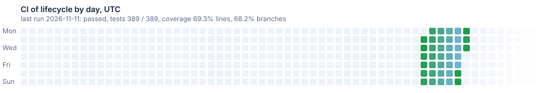

# Sample: lifecycle

The life of a solution, each step a commit of this branch: made with DotNetSolutionKit 2.7.0 alone, as
before dotskit; the team's own change; then dotskit describes it (init), upgrades it to 2.9.1, adds a
service, adds a flag to a service it has, and adds one more with --force. dotskit built the solution after
each command, and the team's change is still in Orders. The CI of this branch runs on the result.

Built from the template's master at ce625d4. Nothing here is edited by hand: the branch is replaced
when the template moves on.

