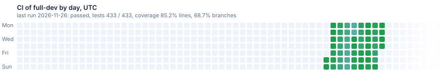
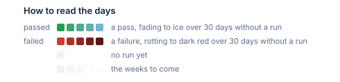

# Sample: full-dev

The flags of full and the ones dev adds before a release, generated from the template's dev once a day when it has moved. A red CI here is a break in dev before a release. Its third service, Notifications, is added by dotskit after the template made the first two.

[](https://dotskit.sawking.tech/samples.html#full-dev)



Each square is a day in UTC, Monday at the top and Sunday at the bottom. A day shows the result of the
last CI run up to it: green for a pass, red for a failure. A day without a run shows how long ago the
run was: after a pass it turns a step bluer every 2 days, after a failure a little darker every day,
ice blue or dark red from day 30 on. A day keeps its colour; a new run makes its day green or red
again. A pale square is a day before the first run; the fading squares on the right are the weeks to
come.

Generated from DotNetSolutionKit dev at [fd4f900](https://github.com/sawking-tech/DotNetSolutionKit/commit/fd4f900d91a24bcee683176052fe303fe96b0af5), not a release, with:

```bash
dotnet new DotNetSolutionKit -N ST -P DotNetSolutionKit.Samples -S Orders --solution --github-cicd true --messaging rabbitmq:outbox -I true --diff-api true --feature-flags true --hierarchy-rules true --storage true --clickhouse true --mongodb true --allow-scripts yes
dotnet new DotNetSolutionKit -N ST -P DotNetSolutionKit.Samples -S Billing --messaging rabbitmq:outbox -I true --diff-api true --feature-flags true --storage true --clickhouse true --allow-scripts yes
dotskit init
dotskit new -S Notifications --notify email --messaging rabbitmq:outbox --diff-api true
```

dotskit is the template's tool, SawKing.DotsKit.Tool of the same version; it ran here with --yes and
--allow-dirty, as the folder was a fresh generation, not a git tree.

Nothing here is edited by hand: the branch is replaced when the template moves on.
